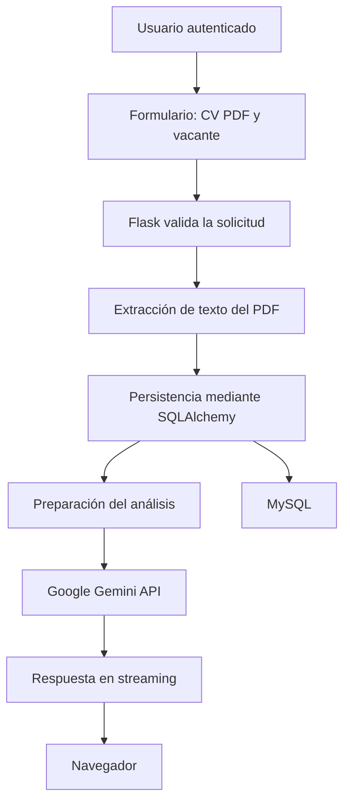

# Yorgan — Analizador de CV con inteligencia artificial

Yorgan es una aplicación web desarrollada con **Python y Flask** que ayuda a analizar un currículum frente a la descripción de una vacante. El usuario carga un archivo PDF, proporciona la descripción del puesto y recibe un análisis generado con **Google Gemini**.

El proyecto integra autenticación, persistencia de datos, procesamiento de archivos e integración con servicios externos. Su objetivo es demostrar el desarrollo de una aplicación backend que conecta diferentes componentes y APIs dentro de un flujo de trabajo completo.

Cuando el despliegue esté disponible, agrega aquí la URL pública de Render
**Demo:** https://proyecto-yorgan.onrender.com

Para ingresar, utiliza la cuenta de demostración precargada:

* **Usuario:** `demo@yorgan.com`
* **Contraseña:** `pass_prueb@283`

## Funciones principales

- **Análisis de CV:** recibe currículums en PDF y una descripción de vacante para generar un análisis con inteligencia artificial.
- **Respuestas en streaming:** entrega progresivamente la respuesta generada por Gemini al cliente, en lugar de esperar a recibir todo el contenido.
- **Autenticación local:** permite registrar usuarios e iniciar sesión con contraseña almacenada mediante hash.
- **Verificación y recuperación de cuenta:** genera enlaces temporales firmados para verificar el correo y restablecer contraseñas.
- **Inicio de sesión con Google:** integra Google OAuth para autenticar usuarios.
- **Persistencia con MySQL:** guarda información de usuarios y datos asociados a los análisis.
- **Validación de archivos y formularios:** acepta archivos PDF, aplica una validación de tamaño de hasta 10 MB y valida que la descripción de la vacante tenga contenido suficiente.
- **Control de solicitudes:** utiliza Flask-Limiter para aplicar límites a determinadas rutas.
- **Observabilidad:** integra Logfire para instrumentar la aplicación; la instrumentación de SQLAlchemy debe verificarse con el motor configurado.
- **Respuestas de error y estado:** incluye manejadores para errores HTTP y una ruta de comprobación de salud.

## Integración con APIs y servicios externos

Una parte central de Yorgan es la comunicación entre el backend y servicios externos. Flask coordina estas integraciones y mantiene la lógica de negocio separada de las rutas.

| Servicio | Uso dentro de Yorgan |
|---|---|
| **Google Gemini API** | Analiza el contenido extraído del CV junto con la descripción de la vacante|
| **Google OAuth / OpenID Connect** | Permite iniciar sesión con una cuenta de Google y consultar la información básica del usuario autorizado|
| **Gmail SMTP** | Envía correos de verificación, recuperación de contraseña y soporte|
| **MySQL** | Persiste usuarios y datos de los análisis|


### Flujo de análisis

1. El usuario autenticado carga un CV en PDF y proporciona la descripción de una vacante.
2. Flask valida el archivo y los datos recibidos.
3. El backend extrae el texto del PDF y guarda la información necesaria para procesar el análisis.
4. La lógica de análisis prepara la solicitud para Google Gemini.
5. Gemini genera el análisis y el backend transmite la respuesta progresivamente al navegador.
6. La aplicación permite consultar la información del análisis asociada al usuario.



### Flujo de autenticación con Google

1. El usuario solicita iniciar sesión con Google.
2. Authlib redirige al usuario al proceso de autorización de Google.
3. Google devuelve al usuario a la ruta callback de la aplicación.
4. El backend intercambia el código de autorización y consulta la información del usuario.
5. Flask-Login administra la sesión dentro de Yorgan.

## Endpoints principales

Las siguientes rutas pertenecen a la aplicación web. Algunas reciben o devuelven datos JSON y otras gestionan páginas y respuestas en streaming.

| Método | Ruta | Descripción |
|---|---|---|
| `GET` | `/` | Página principal. |
| `GET`, `POST` | `/registro` | Registro de usuarios. |
| `GET`, `POST` | `/inicio_sesion` | Inicio de sesión local. |
| `GET` | `/login_google` | Inicia el flujo de autenticación con Google. |
| `GET`, `POST` | `/callback` | Recibe la respuesta del flujo OAuth. |
| `GET`, `POST` | `/analizador` | Muestra el analizador y recibe el PDF y la descripción de la vacante. La solicitud POST devuelve una respuesta JSON con la URL del análisis cuando se procesa correctamente. |
| `GET`, `POST` | `/mostrar/<id_analisis>` | Consulta un análisis o inicia el procesamiento y devuelve la respuesta de Gemini en streaming. |
| `GET` | `/health` | Comprueba el estado de la aplicación y la conexión con la base de datos. |

## Tecnologías

| Área | Tecnología |
|---|---|
| Lenguaje | Python |
| Backend web | Flask |
| Arquitectura | Application Factory y Blueprints |
| ORM / acceso a datos | Flask-SQLAlchemy y SQLAlchemy |
| Base de datos | MySQL |
| Autenticación y sesiones | Flask-Login |
| OAuth | Authlib y Google OAuth / OpenID Connect |
| Formularios y validación | Flask-WTF |
| Protección de contraseñas | Werkzeug Security |
| Tokens firmados | itsdangerous |
| IA generativa | Google Gemini API / Google Gen AI SDK |
| Correo | Flask-Mail |
| Limitación de solicitudes | Flask-Limiter |
| Observabilidad | Logfire |
| Servidor de producción | Gunicorn |
| Despliegue previsto | Render |

## Arquitectura del proyecto

El proyecto utiliza el patrón **Application Factory**. La función `crear_app()` construye y configura la aplicación Flask. Las extensiones se crean sin asociarlas inicialmente a una instancia y se conectan después mediante `init_app()`. Las rutas se organizan en un Blueprint.

```text
.
├── fabrica.py        # Crea y configura la aplicación Flask
├── extensions.py     # Inicializa los objetos de las extensiones
├── auth.py           # Blueprint: autenticación, análisis y páginas
├── forms.py          # Formularios y validaciones
├── services.py       # Operaciones y servicios relacionados con datos
├── funciones.py      # Procesamiento del CV e integración con Gemini
├── templates/        # Plantillas HTML/Jinja
├── static/           # Archivos estáticos (CSS, JavaScript e imágenes)
├── requirements.txt  # Dependencias de Python
└── README.md
```

La estructura anterior muestra los módulos principales identificados en el proyecto. Pueden existir otros archivos y carpetas auxiliares.

## Requisitos

Para ejecutar el proyecto localmente necesitas:

- Python 3.
- Una instancia de MySQL accesible.
- Una API key de Google Gemini.
- Credenciales OAuth de Google si deseas probar el inicio de sesión con Google.
- Credenciales de correo compatibles con SMTP si deseas probar los flujos de envío de correo.

## Instalación y ejecución local

1. Clona el repositorio y entra en la carpeta del proyecto:

   ```bash
   git clone <URL_DEL_REPOSITORIO>
   cd <CARPETA_DEL_PROYECTO>
   ```

2. Crea y activa un entorno virtual.

   **Windows (PowerShell):**

   ```powershell
   python -m venv venv
   .\venv\Scripts\Activate.ps1
   ```

   **Linux / macOS:**

   ```bash
   python3 -m venv venv
   source venv/bin/activate
   ```

3. Instala las dependencias:

   ```bash
   pip install -r requirements.txt
   ```

4. Crea una base de datos MySQL y configura sus credenciales en las variables de entorno. La estructura de tablas debe estar preparada de acuerdo con los modelos y servicios del proyecto.

5. Crea un archivo `.env` en la raíz del proyecto con las variables necesarias (ver la sección siguiente).

6. Inicia la aplicación en modo local:

   ```bash
   python fabrica.py
   ```

   El bloque `if __name__ == "__main__"` de `fabrica.py` inicia el servidor de desarrollo de Flask. No debe utilizarse como servidor de producción.

## Variables de entorno

Configura las siguientes variables en tu archivo `.env` local o en el panel de variables de entorno del proveedor de despliegue. Sustituye los valores de ejemplo por tus propias credenciales.

```dotenv
# MySQL
DB_USER=tu_usuario
DB_HOST=localhost
DB_NAME=tu_base_de_datos
SQLPASS=tu_contrasena

# Flask y tokens
FLASK_LOGIN_KEY=una_clave_secreta_larga_y_aleatoria
KEY_SERIALI=otra_clave_secreta_larga_y_aleatoria

# Correo SMTP
FLASK_MAIL=tu_contrasena_de_aplicacion
MAIL_DEFAULT_SENDER=tu_correo@gmail.com

# Google OAuth
CLIENT_ID=tu_client_id
CLIENT_SECRET=tu_client_secret

# Google Gemini
GEMINI_API_KEY=tu_api_key

# Logfire (si se habilita el envío de telemetría)
LOGFIRE_TOKEN=tu_token_de_logfire

```

**Seguridad:** nunca publiques el archivo `.env`, contraseñas, tokens, claves privadas ni credenciales reales en GitHub. Incluye `.env` en `.gitignore`. En producción, utiliza HTTPS y configura las cookies de sesión y de recuerdo con la opción `Secure`. En el código compartido, Flask-Limiter utiliza `memory://`; para varios procesos o instancias, cambia esa configuración por un almacenamiento compartido (por ejemplo, Redis).

## Despliegue con Render y Gunicorn

La aplicación utiliza una fábrica, no una variable global `app`. Por eso Gunicorn debe importar el módulo `fabrica` y ejecutar `crear_app()`.

Configuración prevista para un servicio web de Render:

**Build Command**

```bash
pip install -r requirements.txt
```

**Start Command**

```bash
gunicorn --bind 0.0.0.0:$PORT "fabrica:crear_app()"
```

Asegúrate de incluir `gunicorn` en `requirements.txt` y registrar en Render todas las variables de entorno requeridas. La ruta `/health` puede utilizarse como Health Check Path.

## Consideraciones de seguridad y uso

- Los usuarios y las contraseñas deben gestionarse mediante los mecanismos de autenticación de la aplicación; no compartas credenciales de prueba en el repositorio.
- Utiliza archivos PDF de prueba. No cargues currículums con información personal real en una demo pública sin definir previamente las medidas de privacidad, retención y eliminación de datos.
- Las claves de Gemini y Google OAuth deben mantenerse como variables de entorno.
- En la configuración compartida, Flask-Limiter utiliza almacenamiento en memoria (`memory://`); para producción con varios workers o instancias, conviene cambiarlo por un almacenamiento compartido.
- Verifica la protección CSRF de las solicitudes AJAX y POST antes de habilitar el uso público.
- Antes de habilitar el uso público, verifica autenticación, protección CSRF, cookies seguras, conexiones a la base de datos y límites de consumo de la API de IA.

## Soporte y reportes

Para reportar un problema o sugerir una mejora, abre un *issue* en este repositorio e incluye los pasos para reproducirlo y el comportamiento esperado. No adjuntes contraseñas, tokens, currículums reales ni otros datos personales.

## Estado del proyecto

Yorgan es un proyecto de desarrollo backend pensado para ser un producto real. Esta documentación describe las funcionalidades y la arquitectura implementadas en el código compartido. La disponibilidad de una demo pública depende de completar y verificar su despliegue y la configuración de los servicios externos.

## Documentación de las tecnologías

- [Flask](https://flask.palletsprojects.com/)
- [Gunicorn](https://gunicorn.org/)
- [Flask-SQLAlchemy](https://flask-sqlalchemy.palletsprojects.com/)
- [Authlib](https://docs.authlib.org/)
- [Google Gemini API](https://ai.google.dev/gemini-api/docs)
- [Google Identity / OpenID Connect](https://developers.google.com/identity/openid-connect/openid-connect)
- [Flask-Limiter](https://flask-limiter.readthedocs.io/)
- [Logfire](https://logfire.pydantic.dev/)

---
